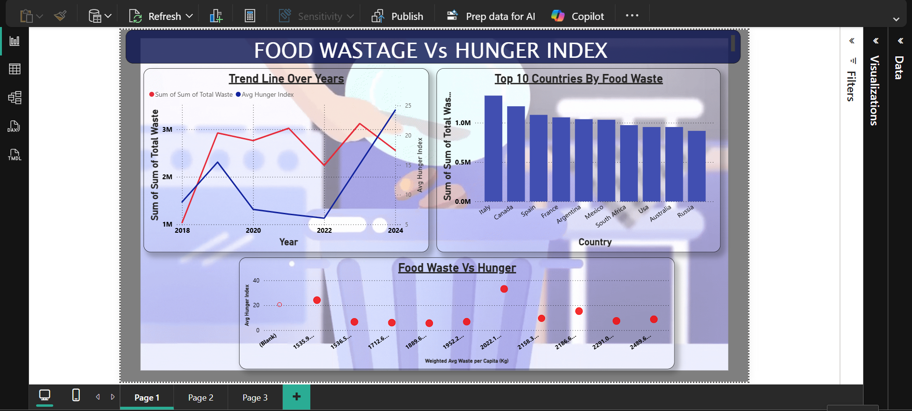
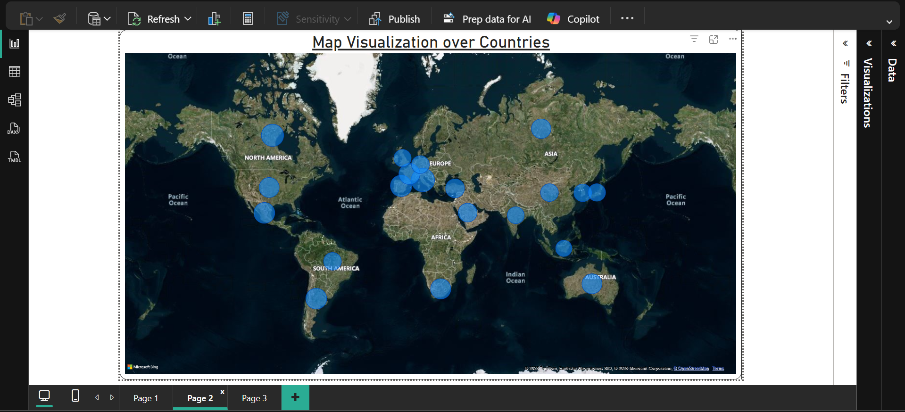
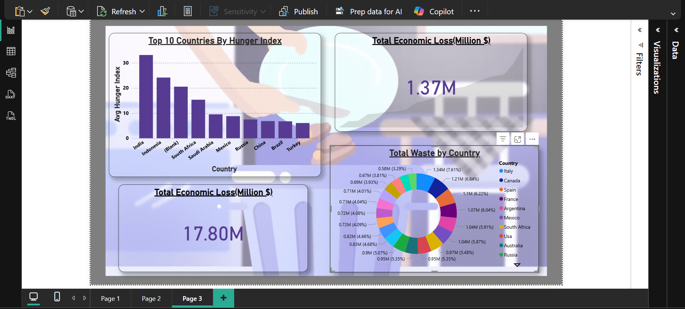

# Food Wastage vs Hunger Index Dashboard

### **Dayananda Sagar University (DSU)**
**Department of Computer Science & Engineering (Data Science)**  
**School of Engineering, Harohalli, Kanakapura Road – 562112**  
**Academic Year:** 2025–26 &bull; **Semester:** 5th Sem B.Tech [Data Science]

---

## 👥 Project Team & Supervisors

- **Student Authors:**
  - **Aravinda Valli** — `ENG23DS0077`
  - **Vaishnavi T P** — `ENG23DS0089`
  - **Varshini B** — `ENG23DS0090`
  - **Yamini Pujar** — `ENG23DS0093`
- **Supervised by:**
  - **Prof. Shashank Shekhar**, Assistant Professor, Dept. of CSE (DS)
  - **Prof. Manjula M**, Assistant Professor, Dept. of CSE (DS)
- **Department Chairperson:**
  - **Dr. Shaila S G**, Professor & Chairperson, Dept. of CSE (DS)

---

## 📌 Project Overview

This project investigates the paradox of global food surplus and hunger coexistence using interactive data analytics across **Power BI**, **Tableau**, and **Power Query**. By merging real-world datasets from Kaggle on the **Global Hunger Index (GHI)** and **Global Food Wastage**, we developed multi-page comparative dashboards highlighting:
1. Top countries suffering from severe hunger vs countries generating massive food waste.
2. The **$17.80 Million** total cumulative economic loss caused by food discard.
3. Food category breakdowns (Prepared food, Bakery, Beverages, Dairy, Produce, etc.).
4. Temporal trends (2018–2024) revealing the decoupling of wastage volume from regional hunger severity.
5. Spatial geographic mapping across North America, Europe, Asia, Africa, and Oceania.

---

## 📊 Dashboard Previews

### 1. Overview & Donut Chart (Hunger Index vs Economic Loss & Waste Distribution)


### 2. Map Visualization over Countries


### 3. Food Wastage vs Hunger Index (Trends & Correlation)


---

## 📂 Repository File Structure

```
food-surplus-hunger-analytics/
│
├── Food_Wastage_vs_Hunger_Dashboard.pbix      # Main Power BI Desktop file (.pbix)
├── Food_Wastage_vs_Hunger.pbip                # Power BI Developer Project (.pbip)
├── Food_Wastage_vs_Hunger.Report/             # Power BI visual layout definition
├── Food_Wastage_vs_Hunger.SemanticModel/      # Power BI semantic tabular data model
│
├── dashboard1.png                             # Page 1 Screenshot
├── map-visualization.png                      # Page 2 Screenshot
├── total-analysis.png                         # Page 3 Screenshot
│
├── index.html                                 # Standalone interactive dashboard web application (One-click launch!)
│
├── data/                                      # Empirical CSV datasets
│   ├── build_datasets.py                      # Python dataset generator
│   ├── global_hunger_index_raw.csv            # Raw GHI scores & severity categories
│   ├── global_food_wastage_raw.csv            # Raw Food Wastage tonnage & economic losses
│   ├── cleaned_merged_food_hunger_dataset.csv # Final merged dataset (Power Query joined on Country)
│   ├── food_waste_categories.csv              # 8 food categories (Tableau Pie Chart)
│   ├── yearly_trends_food_hunger.csv          # 2018-2024 annual trends (Power BI Page 3)
│   ├── tableau_country_waste_tonnage.csv      # Tableau map & bar chart tonnages (5.8M - 6.9M)
│   └── tableau_hunger_entity_2021.csv         # Tableau hunger entity GHI scores (2021)
│
├── power_bi/                                  # Power BI Assets & Config
│   ├── Food_Wastage_vs_Hunger_Dashboard.pbix  # Backup PBIX file
│   ├── PowerQuery_Cleaning_Script.m           # Production M-code for Advanced Editor
│   ├── DAX_Measures.dax                       # Complete DAX formulas (KPIs, Ratios, Ranks)
│   ├── PowerBI_Theme_Exact.json               # Custom Power BI JSON theme with exact colors
│   └── PowerBI_Dashboard_Guide.md             # Click-by-click instructions for Pages 1, 2, 3
│
├── tableau/                                   # Tableau Assets & Config
│   ├── Tableau_Workbook_Specification.md      # Detailed workbook guide for Dashboards 1, 2, 3
│   └── Preferences.tps                        # Custom Tableau XML color palette file
│
├── dashboard_app/                             # Interactive Web App Source
│   ├── index.html                             # Full interactive dashboard application
│   └── build_interactive_app.py               # Build script for web application
│
└── report/                                    # Academic Project Documentation
    ├── DSU_SEC_Project_Report.md              # Complete Project Report in Markdown
    ├── DSU_SEC_Project_Report.html            # Printable / Save-as-PDF formatted report
    └── generate_report.py                     # Report generation pipeline
```

---

## 🚀 How to Run & View the Project

### 1. Power BI Desktop File (`.pbix`)
- Open **`Food_Wastage_vs_Hunger_Dashboard.pbix`** directly in **Power BI Desktop**.
- Both the binary `.pbix` and the modern version-controlled developer format (`Food_Wastage_vs_Hunger.pbip`) are included in this repository.

### 2. Instant Interactive Dashboard (Web Browser)
- Double-click **`index.html`** in this directory to open it in Chrome, Edge, or Firefox.
- **Features**:
  - **Power BI Mode**:
    - **Page 1**: Purple-themed Top 10 Hunger bar chart, `$1.37M` and `$17.80M` KPI cards, and Donut chart with exact 18 country percentages.
    - **Page 2**: Dark satellite interactive Leaflet map with proportional waste bubble markers.
    - **Page 3**: Dual-axis trend line (2018–2024), Top 10 Food Waste bar chart (Slate Blue), and Scatter plot of Waste per Capita vs Hunger Index.
  - **Tableau Mode**:
    - **Dashboard 1**: Vertical bar chart, Rose-pink horizontal bar chart, 8-slice category pie chart, and Bullet graph.
    - **Dashboard 2**: Sequential blue gradient hunger index bars by entity and historical trend line.
    - **Dashboard 3**: Salmon-red world choropleth map.
  - **Dataset Viewer & CSV Exporter**:
    - Inspect clean tabular data and click **Download CSV Data**.

### 3. Loading into Tableau Desktop / Tableau Public
1. Open **Tableau Desktop / Tableau Public**.
2. Connect to Text File -> Select `data/tableau_country_waste_tonnage.csv` and `data/food_waste_categories.csv`.
3. Copy `tableau/Preferences.tps` into your `Documents/My Tableau Repository/Preferences.tps` to enable the project color palettes.
4. Follow `tableau/Tableau_Workbook_Specification.md` to assemble Dashboards 1, 2, and 3.

---

## 🎨 Color Palette & Design System

| Visual Element | Target Metric | Hex Color Code | Sample Preview |
|:---|:---|:---:|:---:|
| **Top 10 Hunger Bars** | Avg Hunger Index | `#543884` | Royal DSU Purple |
| **Top 10 Waste Bars** | Total Waste Tons | `#4361EE` | Slate Blue |
| **KPI Callout Text** | Economic Loss ($M) | `#543884` | Deep Purple |
| **Trend Line (Waste)** | Total Food Waste | `#E63946` | Crimson Red |
| **Trend Line (Hunger)** | Avg Hunger Index | `#1E3A8A` | Navy Blue |
| **Scatter Markers** | Correlation Dots | `#E63946` | Bright Red |
| **Tableau Bar Graph** | Country Waste | `#D85A87` | Rose Pink |
| **Tableau Hunger Gradient** | GHI 2021 | `#93C5FD` &rarr; `#1E3A8A` | Sequential Blue |
| **Tableau Choropleth** | Total Waste Map | `#FFB4A2` &rarr; `#9D0208` | Salmon-Red Ramp |

---

## 📊 Key Findings & Results

1. **High food waste does not correspond to high hunger**: Developed nations (Italy, Canada, Spain, USA) waste the highest amounts per capita (> 2,200 kg) and suffer economic losses up to $1.37M each, yet maintain low hunger scores (< 5.0).
2. **Hunger is concentrated in vulnerable regions**: Nations like India (33.2), Indonesia (24.1), and Ethiopia (20.5) face severe food insecurity driven by distribution bottlenecks and supply chain gaps.
3. **The world is not short of food; it is short of proper planning and distribution**: Eliminating systemic supply-chain waste could easily nourish global hunger hotspots.
